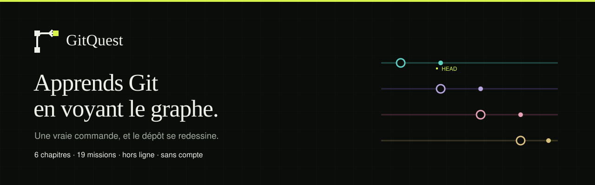
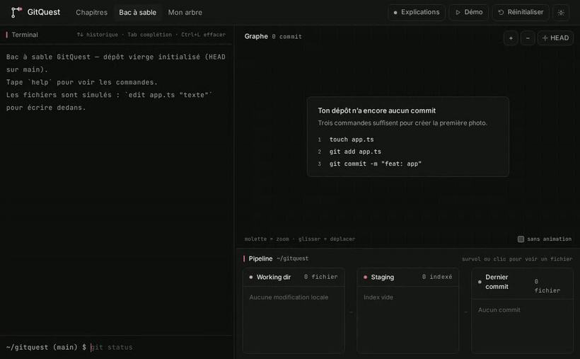
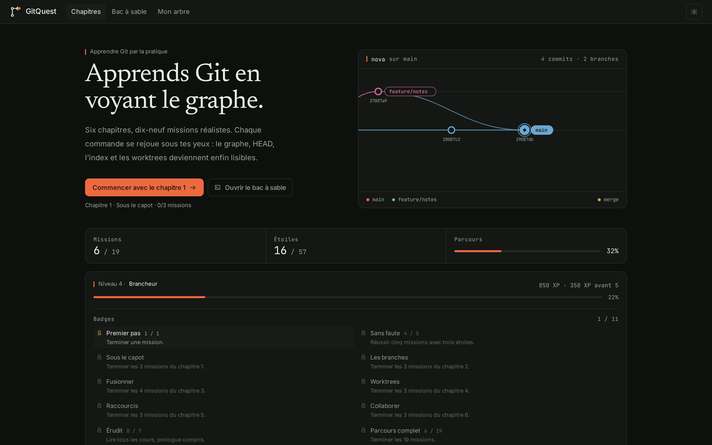
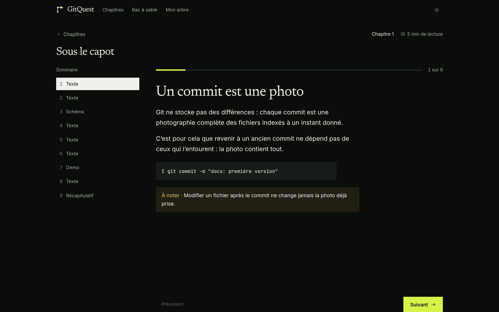
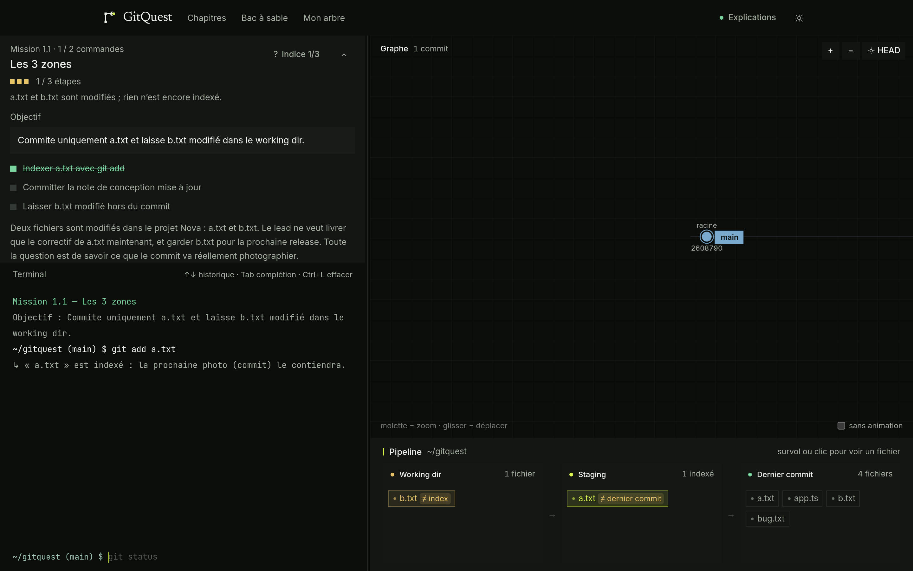
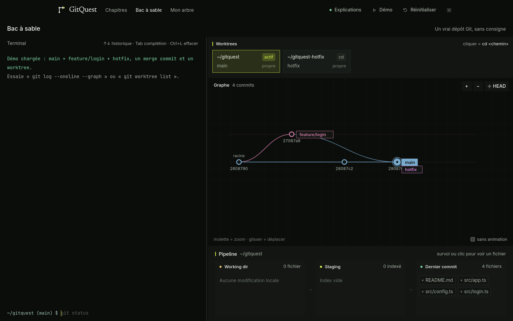
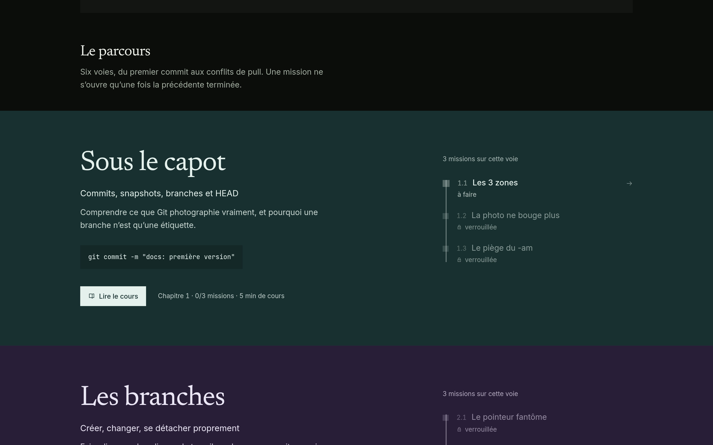
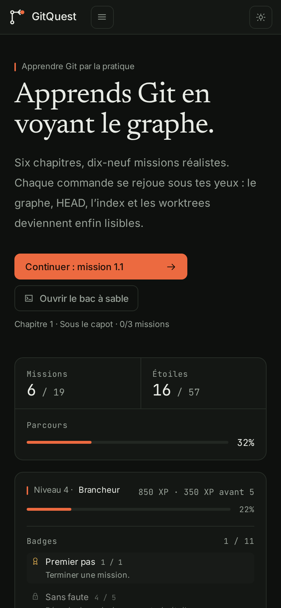

<p align="center">
  
</p>

<h1 align="center">GitQuest</h1>

<p align="center">
  <strong>Learn Git without the pain.</strong><br>
  A free game, in your browser or on Android, where every command becomes a picture.
</p>

<p align="center">
  <a href="https://mattiaparrinello.github.io/git-quest/"></a>
  <a href="https://github.com/MattiaPARRINELLO/git-quest/releases/latest"></a>
</p>

<p align="center">
  
  
  
  
  
</p>

<p align="center">
  
</p>

<p align="center">
  <sub>You type a real Git command; the graph draws itself before your eyes.</sub>
</p>

---

## Git isn't hard. It's invisible.

Everyone knows `git commit`, `git merge`, `git pull`. And almost nobody knows what
actually happens when you type them. So we memorise commands, copy a colleague's, and
we're afraid of breaking something.

GitQuest makes that mechanism **visible**.

- You type `git switch -c feature` → a new branch appears, and you understand that a
  branch is just a label that moves.
- You commit → the file goes from disk to the index, then becomes a dot in the graph.
  You finally see the three areas.
- You merge → the line draws itself, with or without a merge commit. No more abstract
  diagram to imagine.
- You make a mistake → Git answers exactly as it really would ("local changes would be
  overwritten", "fetch first"...), and you understand why.

No video to watch passively. No quiz to tick. You play, you manipulate, you remember.

> **In short:** GitQuest is a real miniature Git repository in your browser, with a
> terminal, an animated graph and a guided path to learn step by step.

---

## Who is it for?

- **You're new to Git** and never know which branch you're on.
- **You use it every day** but would like to understand worktrees, merges and conflicts.
- **You're teaching someone** and looking for hands-on material, with no installation.
- **You like understanding** how tools work under the hood.

No prerequisites: no account, no repository to create, no risk of breaking anything. The
worst that can happen is restarting a mission.

---

## How it works

1. **A short lesson** (3 to 5 min) explains a concept with an animated diagram and a real
   demo: not a screenshot, real commands replayed.
2. **Three or four missions** put that concept into practice in a realistic team situation:
   a bug in production, a colleague pushing at the same time, a lost commit.
3. **You type the commands** in the terminal. The graph, HEAD, the index and the worktrees
   react immediately, with an explanation in English.
4. **You're scored on efficiency**: a reference solution, hints if you get stuck, and up
   to 3 stars depending on how many commands you used.

Two or three hours are enough to complete the whole path. And if you just want to try
things without a lesson, the **sandbox** is always open: a free Git terminal, with the
same graph.

Each chapter has **its own colour**, the same as its lane in the graph: the progress map
reads like a repository, and HEAD marks the mission you're on. A single vivid accent,
reserved for action.

---

## Preview

<table>
  <tr>
    <td width="50%">
      
      <p align="center"><sub><b>Home</b>: where you are, and the repository you're building.</sub></p>
    </td>
    <td width="50%">
      
      <p align="center"><sub><b>Lessons</b>: one concept, one diagram, one played demo.</sub></p>
    </td>
  </tr>
  <tr>
    <td width="50%">
      
      <p align="center"><sub><b>Missions</b>: a real situation, hints, stars.</sub></p>
    </td>
    <td width="50%">
      
      <p align="center"><sub><b>The sandbox</b>: just you and Git, no instructions.</sub></p>
    </td>
  </tr>
</table>

<p align="center">
  
  <br>
  <sub><b>The path</b>: six lanes, one colour per chapter, your missions placed on them.</sub>
</p>

<p align="center">
  
  <br>
  <sub>It also works on a phone: in the browser, or as an Android APK.</sub>
</p>

---

## The path

**6 chapters, 19 missions, one prologue.** Missions unlock as you go, and every chapter
starts with a lesson.

| Chapter | What you'll finally understand |
|---------|-------------------------------|
| **1 · Under the hood** | What a commit really is, what the working directory, the index and HEAD are for. |
| **2 · Branches** | Why a branch is just a pointer, how to switch without losing anything, why a commit can become orphaned. |
| **3 · Merging** | The difference between fast-forward and merge commit, and how to resolve a conflict without panicking. |
| **4 · Worktrees** | Working on two things at once, fixing production without touching your draft. |
| **5 · Shortcuts** | The commands that do several things at once, and when to use them. |
| **6 · Collaborating** | Remotes, `push`, `fetch`, `pull`, upstream, and the famous "fetch first". |

A **prologue** gets you off on the right foot: reading a command, understanding options,
quotes and placeholders.

By the end, you haven't memorised a list of commands: you can **read a Git graph and
predict what a command will do**.

---

## A story, not a list of exercises

Missions follow a continuous plot: a small team, a project called Nova, colleagues who
commit at the same time as you. Each mission has a dialogue intro and an epilogue, so the
exercises feel like real work situations.

As you play, you build **your own** Git tree. At the end, the "Your Nova tree" screen
shows the complete graph you created, with commits, branches, merges and worktrees, and
lets you export it as an image.

---

## Reasons to keep going

- **Stars** on every mission: 3 if you reach the goal with the minimum number of commands,
  2 if you lag a little, 1 otherwise. You can always replay for a better score.
- **XP and levels**, from "Novice" to "Repository Master", computed from your real
  progress.
- **11 badges**: one per chapter, but also "Flawless" for five three-star missions, or
  "Scholar" for reading every lesson.
- **Predictions**: sometimes, before running a command, the game asks what will happen.
  You answer by clicking on the graph, then check. It's the best way to spot what you only
  think you understood.

Your progress is saved locally, on your device. Nothing leaves for a server.

---

## Getting started

The simplest way: **<https://mattiaparrinello.github.io/git-quest/>**. It opens right
away, with no account.

You can also install it as an app: in your browser, look for the "Install" icon in the
address bar. Once installed, GitQuest works **offline**, including on the train.

### On Android, as an APK

Download the signed APK from the
[GitHub releases](https://github.com/MattiaPARRINELLO/git-quest/releases/latest) (4 MB).
Android asks you to allow installs from that source, then the whole game lives on the
device: no network needed to start, no account, no browser.

It's the same app as the web version, packaged: the terminal gains a key bar
(`-`, `"`, `/`, `.`, `_`, `~`, space, `Tab`, history, `Enter`) to type Git with your thumb
without closing the keyboard, completion suggestions are tapped with a finger, and the
graph zooms with two fingers.

> **Tip**: start with the prologue, then chapter 1. You can also open the sandbox directly
> if you just want to try commands.

---

## FAQ

**Can I break something?**
No. Everything happens in your browser, on a simulated repository. Nothing is real,
nothing is sent, and you can reset everything with one button.

**Do I need to know Git?**
No. The prologue and chapter 1 start from zero. If you already know the basics, you can
skip the lessons and jump straight into missions.

**Are these real Git commands?**
Yes: the syntax, outputs and error messages follow Git. The engine is a faithful
reimplementation in TypeScript, not a skin.

**How long does it take?**
About 2 to 3 hours for the whole path, across several sessions. Progress is kept.

**Does it work on a phone?**
Yes. The interface adapts into Terminal / Graph / Files tabs, with a key bar for Git
characters and a graph that zooms with your fingers. There's also an **Android APK** to
install from the releases, to play without a browser.

**Are my stars kept if I change device?**
Not automatically: progress stays on the device. The home screen offers "Backup" /
"Restore": a JSON text to copy, containing your stars, the lessons you've read and your
Nova tree.

**Is it free?**
Yes, with no ads and no account.

---

## Under the hood

For the curious and the developers: GitQuest is a React + TypeScript PWA, with no backend.
The Git engine (`src/engine/`) is **pure** (no access to the DOM, storage or the system
clock), which makes it fully testable and reproducible. The content (lessons, missions,
predictions) is typed data, never text hard-coded in a component.

```bash
npm ci
npm run dev          # local development
npm test             # the whole Vitest suite
npm run check        # typecheck + content invariants + i18n parity
npm run build        # PWA build
npm run android:apk  # development Android APK
npm run android:aab  # signed AAB + APK, for the Play Store
```

Two deliverables, one codebase: the `dist/` produced by Vite powers the PWA and is
embedded as-is in the Capacitor shell. The only differences are declarative: platform
detection in `src/native/`, touch affordances mounted based on screen size. Never a second
rendering to maintain.

Technical documentation: [`docs/ARCHITECTURE.md`](docs/ARCHITECTURE.md) ·
[`docs/VERIFY.md`](docs/VERIFY.md) · [`docs/CI.md`](docs/CI.md) ·
[`docs/STORY-REPO.md`](docs/STORY-REPO.md) · [`docs/NATIVE-ANDROID.md`](docs/NATIVE-ANDROID.md),
and on the Android side: [`docs/ANDROID-VERIFY.md`](docs/ANDROID-VERIFY.md) (testing on a
device) and [`docs/RELEASE.md`](docs/RELEASE.md) (signing and Play Store).

Want to contribute? The getting-started guide, conventions and tooling commands are in
[`CONTRIBUTING.md`](CONTRIBUTING.md). To write a mission:
[`docs/CONTENT.md`](docs/CONTENT.md). To translate the interface or a chapter:
[`docs/I18N.md`](docs/I18N.md).

The interface is available in French and English via the `FR` / `EN` selector in the top
bar. The learning content stays in French until its translation ships; the infrastructure
and the translation guide are in place.

---

<p align="center">
  <sub>GitQuest: learn Git by seeing it. Progress stored only on your device.</sub>
</p>
