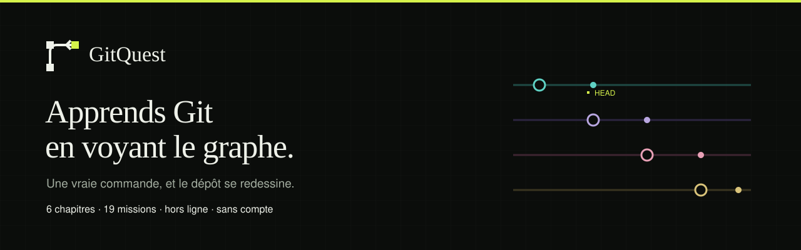
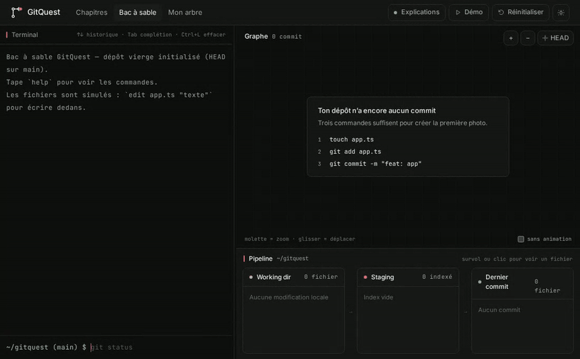
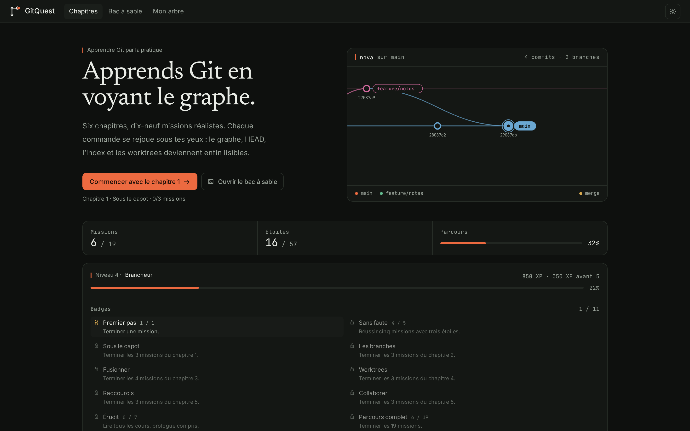
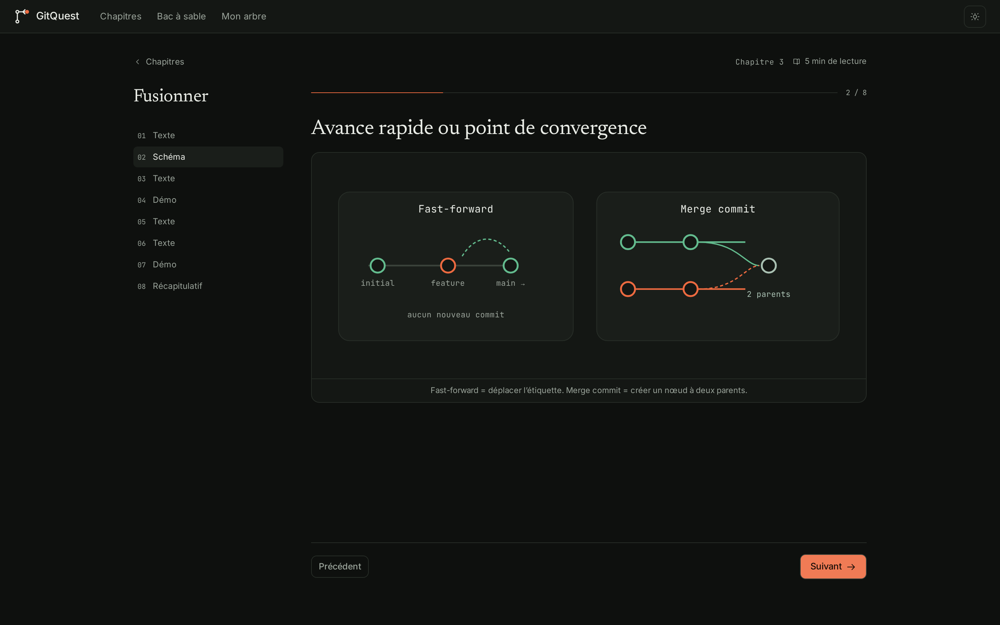
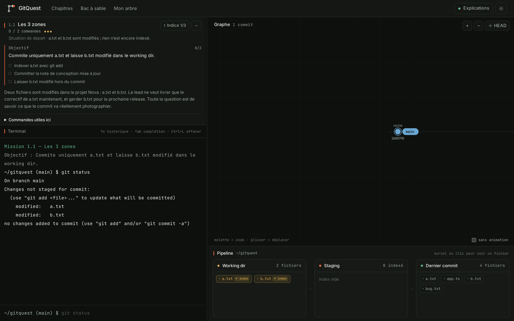
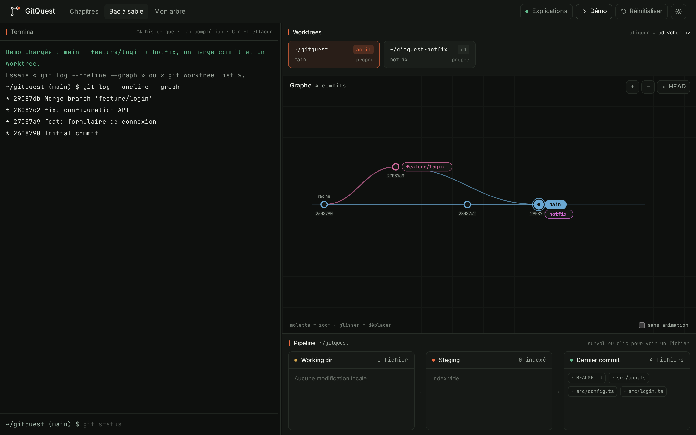
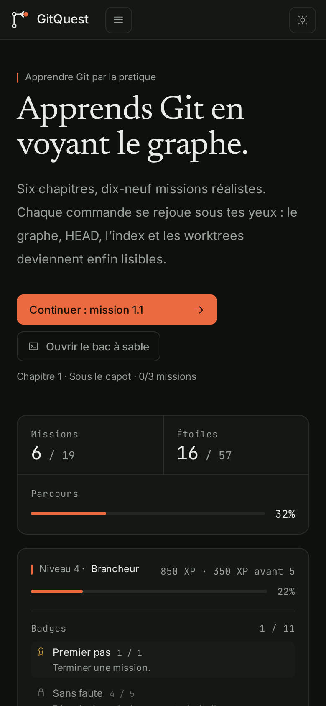

<p align="center">
  
</p>

<h1 align="center">GitQuest</h1>

<p align="center">
  <strong>Apprends Git en voyant le graphe.</strong><br>
  Une PWA pédagogique : un terminal simulé, un graphe de commits animé et un moteur Git pur TypeScript.
</p>

<p align="center">
  <a href="https://mattiaparrinello.github.io/git-quest/"><strong>▶ Démo en ligne</strong></a>
</p>

<p align="center">
  <a href="https://www.typescriptlang.org/"></a>
  <a href="https://react.dev/"></a>
  <a href="https://vite.dev/"></a>
  
  <a href="https://vitest.dev/"></a>
  
</p>

<p align="center">
  
</p>

GitQuest est un jeu de poche pour comprendre ce que Git fait réellement. Tu tapes de
vraies commandes dans un terminal ; le graphe, HEAD, l'index, le working directory et
les worktrees se mettent à jour sous tes yeux, avec des explications en français.

Le moteur Git est écrit en TypeScript pur, sans dépendance, et tourne **entièrement
dans le navigateur** : aucune donnée ne quitte l'appareil, rien n'est envoyé nulle part.
L'application s'installe comme une PWA et fonctionne hors ligne.

---

## Sommaire

- [Pourquoi GitQuest](#pourquoi-gitquest)
- [Aperçu](#aperçu)
- [Le parcours](#le-parcours)
- [Ce que sait faire le simulateur](#ce-que-sait-faire-le-simulateur)
- [Démarrage rapide](#démarrage-rapide)
- [Scripts](#scripts)
- [Architecture](#architecture)
- [Qualité et intégration continue](#qualité-et-intégration-continue)
- [Ajouter une commande](#ajouter-une-commande)
- [Ajouter une mission](#ajouter-une-mission)
- [Limites assumées](#limites-assumées)
- [Documentation](#documentation)

---

## Pourquoi GitQuest

La plupart des tutoriels Git montrent des schémas statiques ou une suite de commandes à
recopier. On retient la commande, pas le modèle mental. GitQuest fait l'inverse :

- **Tu vois l'effet avant de le comprendre.** Chaque commande rejoue ses conséquences
  sur le graphe, pas dans une animation décorative : les nœuds et les branches sont
  calculés à partir de l'état réel du dépôt.
- **Le moteur est du vrai Git, en miniature.** Snapshots complets, parents multiples,
  merge 3-way, conflits praticables, refus de checkout avec modifications locales,
  remotes avec upstream et refus non fast-forward.
- **Le contenu est de la donnée.** Cours, missions, prédictions et briefings vivent dans
  `src/content/` — aucun texte de leçon n'est codé dans un composant.
- **Tout reste local.** Progression et dépôt du bac à sable sont stockés dans IndexedDB.

---

## Aperçu

<table>
  <tr>
    <td width="50%">
      
      <p align="center"><sub><b>La carte</b> — parcours, XP, niveaux et badges dérivés de la progression.</sub></p>
    </td>
    <td width="50%">
      
      <p align="center"><sub><b>Les cours</b> — texte, diagrammes, mini-démos rejouées avec le vrai moteur.</sub></p>
    </td>
  </tr>
  <tr>
    <td width="50%">
      
      <p align="center"><sub><b>Les missions</b> — objectif, checklist en direct, indices progressifs, étoiles.</sub></p>
    </td>
    <td width="50%">
      
      <p align="center"><sub><b>Le bac à sable</b> — terminal, worktrees, graphe SVG et pipeline.</sub></p>
    </td>
  </tr>
</table>

<p align="center">
  
  <br>
  <sub>Sur mobile : onglets Terminal / Graphe / Fichiers, PWA installable.</sub>
</p>

---

## Le parcours

**6 chapitres · 19 missions · un prologue.** Les cours précèdent toujours le concept
utilisé par une mission, et les missions se déverrouillent linéairement (le bac à sable,
lui, reste toujours accessible).

| # | Chapitre | Idée centrale | Missions |
|---|----------|---------------|----------|
| 1 | **Sous le capot** | Commits, snapshots, branches et HEAD | 1.1 Les 3 zones · 1.2 La photo ne bouge plus · 1.3 Le piège du `-am` |
| 2 | **Les branches** | Créer, changer, se détacher proprement | 2.1 Le pointeur fantôme · 2.2 Qui avance ? · 2.3 Le commit perdu |
| 3 | **Fusionner** | Avance rapide, merge commit, nettoyage | 3.1 Livrer sans cérémonie · 3.2 Le point de convergence · 3.3 Le ménage · 3.4 Le guide déchiré |
| 4 | **Worktrees** | Deux branches, deux bureaux, un dépôt | 4.1 Le bug de prod · 4.2 Deux casquettes · 4.3 Ranger le chantier |
| 5 | **Raccourcis** | Une intention, une commande | 5.1 Un fichier, une commande · 5.2 Créer et rejoindre en une fois · 5.3 Tout le chantier d'un coup |
| 6 | **Collaborer** | Remote, push, pull, conflits de pull | 6.1 Mettre Nova en ligne · 6.2 Le commit du coéquipier · 6.3 Le même fichier, deux versions |

Autour des missions :

- **Prologue** « Lire une commande Git » : programme, sous-commande, options,
  guillemets et placeholders — de quoi décoder n'importe quelle commande.
- **Histoire continue « Nova »** : chaque mission a une intro en dialogue, un épilogue et
  une accroche. Les commits des coéquipiers sont attribués sans jamais modifier tes
  commandes ; `#/nova` permet de revoir l'arbre complet en lecture seule, d'exporter un
  PNG et de copier un `git log --oneline --graph`.
- **Prédictions** : avant certaines commandes, l'exécution est suspendue ; tu réponds en
  cliquant un commit ou une étiquette du graphe, puis la commande s'exécute et le
  feedback explique. Rien ne bloque : on peut toujours passer.
- **XP, niveaux et badges** dérivés de la progression (jamais un compteur séparé) :
  100 XP par mission et 25 par étoile, 7 paliers de « Novice » à « Maître du dépôt »,
  11 badges (chapitre, série parfaite, cours lus).
- **Étoiles** : 3 si tu atteins l'objectif en `par` commandes ou moins, 2 si `par + 2`,
  sinon 1.

---

## Ce que sait faire le simulateur

| Domaine | Commandes |
|---------|-----------|
| Dépôt | `git init`, `git status` (avec relation à l'upstream) |
| Index et commits | `git add`, `git commit -m`, `-am`, `git commit -m "msg" <chemins>`, `git log --oneline --graph` |
| Diff | `git diff`, `git diff --staged`, `git diff HEAD` — format unifié, calculé par LCS |
| Branches | `git branch [<nom> [<start>]]`, `-d`, `-D`, `git switch`, `git switch -c`, `git checkout` |
| Fusion | `git merge` : fast-forward, merge commit, conflits 3-way, `--continue`, `--abort` |
| Distant | `git remote [-v\|add\|remove]`, `git push [-u]`, `git fetch`, `git pull` |
| Worktrees | `git worktree add` (+ `-b`), `git worktree list`, `git worktree remove` |
| Fichiers | `git rm`, `touch`, `edit`, `cat`, `rm`, `ls`, `cd` |
| Aide | `help`, `explain <commande>` (dry-run), `undo`, `hint`, `reset-mission` |

Points de fidélité qui comptent pédagogiquement :

- les messages d'erreur suivent Git (`local changes would be overwritten`,
  `! [rejected] … (fetch first)`, `Cannot delete branch 'x' checked out at '…'`) ;
- un `git checkout` refuse d'écraser des modifications locales, mais les emporte quand
  la version du fichier est identique entre source et cible ;
- un conflit de merge n'est **pas** une erreur : le disque reçoit les marqueurs,
  `git status` liste `Unmerged paths`, et `git add` puis `commit`/`--continue` concluent ;
- `git push` refuse tout ce qui n'est pas un fast-forward distant après un
  `git fetch` — exactement comme GitHub.

Hors périmètre : rebase, cherry-pick, reset/revert, stash, reflog, bisect, pull requests
réelles, comptes et backend.

---

## Démarrage rapide

Pas envie d'installer ? La démo tourne en ligne :
**<https://mattiaparrinello.github.io/git-quest/>**.

Prérequis : **Node.js 22+** et npm.

```bash
git clone <url-du-depot> gitquest
cd gitquest
npm ci
npm run dev
```

Vite affiche l'URL locale. Pour une URL stable (recommandé par ce projet), lance le
serveur à travers Portless :

```bash
portless gitquest npm run dev
# → https://gitquest.localhost
```

Puis ouvre `https://gitquest.localhost`. La PWA s'installe depuis le navigateur
(icône d'installation dans la barre d'adresse) et fonctionne ensuite hors ligne.

Routes :

| Route | Écran |
|-------|-------|
| `#/` | Carte des chapitres et progression |
| `#/prologue` | Lire une commande Git |
| `#/chapter/:id/lesson` | Cours du chapitre |
| `#/mission/:id` | Mission |
| `#/interlude/:chapterId` | Transition entre chapitres |
| `#/nova` | L'arbre de l'histoire (lecture seule) |
| `#/sandbox` | Bac à sable libre |

---

## Scripts

| Commande | Rôle |
|----------|------|
| `npm run dev` | Serveur de développement Vite |
| `npm run typecheck` | `tsc --noEmit` en mode strict — obligatoire avant commit |
| `npm test` | Vitest : moteur, contenu, layout, composants |
| `npm run coverage` | Couverture (rapport texte + JSON) |
| `npm run build` | Typecheck + build PWA, génère `dist/sw.js` |
| `npm run preview` | Sert le build et vérifie le mode hors ligne |
| `npm run ci:dist` | Inspecte `dist/` : manifest, service worker, budgets de taille |
| `npm run ci:coverage` | Compare la couverture aux planchers |
| `npm run ci:smoke` | Smoke test HTTP d'un `vite preview` |
| `npm run ci:all` | `typecheck` + `build` + `ci:dist` |

Après chaque modification : `npm run typecheck && npm test && npm run build`.

---

## Architecture

```
src/
├─ engine/         moteur Git pur : types, parsing, commandes, worktrees, diff, validations
├─ app/            explain / undo / hint / reset-mission, score, XP, niveaux, badges
├─ explanations/   événement Git → phrase française
├─ content/        chapitres, cours, missions, prédictions, briefings (données typées)
├─ story/          chaîne narrative « Nova », slots, journal (pur, sans React)
├─ components/
│  ├─ graph/       layoutGraph (pur, testé) + CommitGraph (SVG, Framer Motion)
│  ├─ terminal/    terminal, historique, complétion Tab
│  ├─ pipeline/    working dir → index → dernier commit
│  ├─ worktrees/   cartes de worktrees cliquables
│  ├─ mission/     panneau mission, briefing, prédictions
│  ├─ lesson/      slides, diagrammes, mini-démos
│  ├─ progress/    XP, niveaux, badges
│  └─ ui/          primitives partagées
├─ store/          Zustand : dépôt, mission, progression, UI
├─ storage/        StorageAdapter + IndexedDB (idb-keyval) + mémoire (tests)
├─ screens/        accueil, cours, mission, sandbox, Nova, interludes
├─ router/         routeur maison par hash, sans dépendance
└─ styles/         tokens CSS, thèmes sombre (défaut) et clair
```

Quatre règles tiennent l'ensemble :

1. **Le moteur est pur.** Aucun import React, DOM, stockage, `Date.now()` ou
   `Math.random()`. L'horloge logique (`clock`) et le compteur (`nextId`) vivent dans
   `RepoState`, ce qui rend chaque scénario reproductible.
2. **Une commande est une fonction.** `execute(state, command)` rend un nouvel état
   immuable, des lignes de terminal, des `GitEvent` et une erreur éventuelle. En cas
   d'erreur, `newState === state`.
3. **Le graphe ne diff jamais deux états.** `layoutGraph(state)` est pur et testé ;
   l'animation consomme les `GitEvent` émis par la commande. x = ordre de création du
   commit, lane = `Commit.branch` : un commit existant ne bouge jamais.
4. **Pas de `any`.** Unions discriminées, `readonly`, `exactOptionalPropertyTypes`.

---

## Qualité et intégration continue

`.github/workflows/ci.yml` rejoue tout à chaque push sur `main` et à chaque pull request :

| Job | Contenu |
|-----|---------|
| `verify` (Node 22 et 24) | `npm ci`, `typecheck`, `test`, `build`, inspection de `dist/` |
| `coverage` | Vitest + couverture comparée aux planchers de `ci/check-coverage.mjs` |
| `smoke` | `vite preview` + vérifications HTTP réelles : HTML, assets, manifest, service worker, icônes, route inconnue |
| `audit` | `npm audit --omit=dev --audit-level=high` bloquant |
| `dependencyReview` | Revue des dépendances sur les PR (indicatif) |
| `gate` | Agrège les résultats ; c'est le check à cocher en protection de branche |

`ci/check-dist.mjs` échoue si le manifest est incomplet, si une icône n'a pas les bonnes
dimensions, si des source maps fuient dans `dist/`, ou si un budget est dépassé :
`dist/` ≤ 4 Mio, JS ≤ 250 kB gzip, CSS ≤ 40 kB gzip.

Détails et reproduction locale : [`docs/CI.md`](docs/CI.md).

---

## Ajouter une commande

1. Ajouter le cas dans `src/engine/parse/parse-command.ts` (et `ParsedCommand` dans
   `types.ts` si nécessaire).
2. Créer `src/engine/commands/<commande>.ts` : une fonction pure
   `(state, command) => ExecuteResult`.
3. L'enregistrer dans `src/engine/commands/registry.ts`.
4. Émettre les `events` dans l'ordre causal : fichiers → graphe → HEAD → worktrees.
5. Ajouter l'événement dans `GitEvent` et sa phrase dans `src/explanations/fr.ts`.
6. Ajouter `src/engine/__tests__/<commande>.test.ts` : succès, erreurs, état inchangé en
   cas d'échec.

---

## Ajouter une mission

Une mission est un fichier dans `src/content/chapters/<chapitre>/missions/<id>.ts`,
référencé dans le `index.ts` du chapitre :

```ts
export const mission: Mission = {
  id: 'worktree-hotfix',
  chapterId: 'worktrees',
  order: 1,
  title: 'Le bug de prod',
  story: '…',                          // 3 phrases max
  situation: 'HEAD est sur feature avec un WIP non commité.',
  objective: 'Corrige la prod sans toucher à ton WIP.',
  steps: [
    { label: 'Créer le worktree hotfix', done: (state) => worktreePaths(state).length === 2 },
    { label: 'Commiter le correctif', done: (state) => headFile(state, 'bug.txt') === 'corrigé' },
  ],
  takeaway: 'Un worktree est un second bureau sur le même dépôt.',
  difficulty: 3,
  par: 8,
  initialState: scenario()
    .init()
    .commit('Initial', { 'bug.txt': 'bug' })
    .branch('feature')
    .checkout('feature')
    .write('src/app.ts', 'wip')
    .build(),
  validate: (state) => check(branchFile(state, 'hotfix', 'bug.txt') === 'corrigé', '…'),
  forbidden: [{ prefix: 'git stash', message: '…' }],
  hints: ['vague', 'précis', 'solution'],
  solution: ['git worktree add ../hotfix -b hotfix main', 'cd ../hotfix', '…'],
  suggestedCommands: ['git status', 'git worktree list', 'git worktree add ../hotfix -b hotfix main'],
};
```

Règles de contenu :

- 2 à 4 `steps`, dont les premières sont fausses sur l'état initial ;
- 3 indices progressifs et 3 à 5 `suggestedCommands` ;
- `par` égal à la longueur de `solution` ;
- un test qui rejoue `solution`, vérifie `validate(state).ok === true` **et** que l'état
  initial ne valide pas la mission (voir `src/engine/__tests__/missions.test.ts`).

---

## Limites assumées

Ce projet privilégie la clarté pédagogique à l'exhaustivité. Les écarts avec Git sont
documentés et testés :

- les hashes sont déterministes et non cryptographiques (`abc1234`-like), pour des tests
  et des missions stables ;
- un remote partage les objets du dépôt local : seules les références sont transférées ;
- pour un conflit modification/suppression, les marqueurs sont écrits avec une section
  vide afin de rendre le conflit visible (le statut, lui, est fidèle) ;
- si le merge d'un `pull` échoue, le fetch est annulé avec l'état, alors que Git
  conserve les références récupérées.

La liste complète et les scénarios de vérification sont dans
[`docs/ARCHITECTURE.md`](docs/ARCHITECTURE.md) et [`docs/VERIFY.md`](docs/VERIFY.md).

---

## Documentation

| Document | Contenu |
|----------|---------|
| [`docs/ARCHITECTURE.md`](docs/ARCHITECTURE.md) | Contrat du moteur, modèle de données, layout, persistance |
| [`docs/VERIFY.md`](docs/VERIFY.md) | Scénarios à comparer avec un vrai Git |
| [`docs/CI.md`](docs/CI.md) | Jobs, budgets, smoke test, dépannage |
| [`docs/STORY-REPO.md`](docs/STORY-REPO.md) | Chaîne narrative « Nova » et slots |
| [`AGENTS.md`](AGENTS.md) | Conventions et règles d'architecture du dépôt |

---

<p align="center">
  <sub>GitQuest — progression et dépôt enregistrés uniquement sur cet appareil.</sub>
</p>
